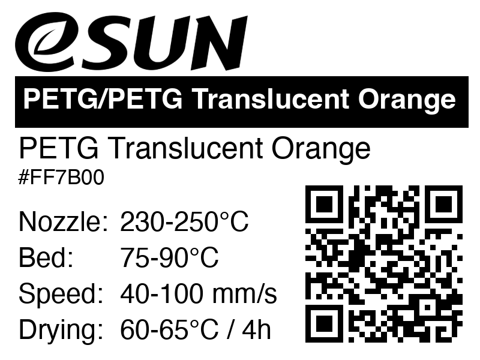
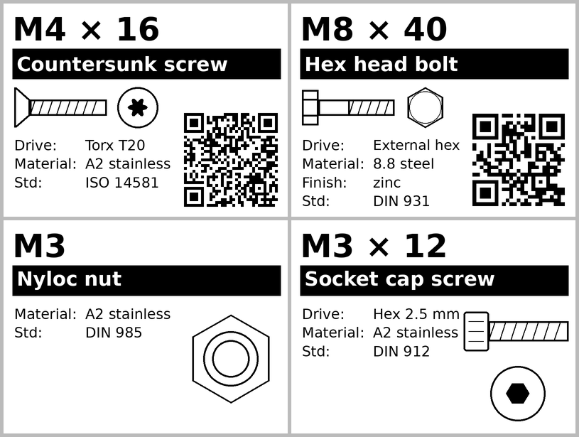

# Spoolman Label Designer

Generate printable 40x30mm thermal labels for your 3D printing filament spools. Pulls spool and filament data directly from a [Spoolman](https://github.com/Donkie/Spoolman) instance and renders a label with:

- Brand name (or manufacturer logo)
- Material and filament name
- Color name and hex code
- Nozzle, bed, and drying temperatures
- Printing speed
- QR code linking back to the spool in Spoolman

Output as PNG images or as AML files compatible with the Labelife/Phomemo M110 thermal printer.



## Requirements

- Python 3.11+
- A running [Spoolman](https://github.com/Donkie/Spoolman) instance

## Installation

```bash
git clone https://github.com/leolobato/spoolman-designer.git
cd spoolman-designer

python3 -m venv .venv
source .venv/bin/activate
pip install -r requirements.txt
```

## Quick Start

List all your spools:

```bash
python generate_label.py list --url http://your-spoolman:7912
```

Generate a PNG label for spool #8:

```bash
python generate_label.py generate 8 --png --url http://your-spoolman:7912
```

You can also pass just a spool ID as a shorthand:

```bash
python generate_label.py 8 --png
```

## Usage

```
python generate_label.py <command> [options]
```

### Commands

**list** -- Show all spools from Spoolman with their IDs, brand, material, color, and remaining weight.

**generate \<spool_id\>** -- Render a label for the given spool. Options:

| Flag | Description |
| --- | --- |
| `--png` | Output as PNG image (default) |
| `--aml` | Output in Labelife AML format for M110 printers |
| `--logo` | Use the manufacturer logo instead of the text brand name |
| `-o FILE` | Set the output filename (auto-generated by default) |
| `-u URL` | Spoolman base URL |

### Spoolman URL

The Spoolman URL is resolved in this order:

1. `--url` / `-u` flag
2. `SPOOLMAN_URL` environment variable
3. `spoolman_url` in `config.toml`
4. `http://localhost:7912`

## Configuration

You can create an optional `config.toml` in the project root to set defaults. See `config.example.toml` for reference.

```toml
spoolman_url = "http://localhost:7912"
output_format = "aml"   # "aml" or "png"
output_dir = "output"
use_logo = true
```

This file is gitignored. All keys are optional. CLI flags and environment variables take priority over config values.

## Spoolman Custom Fields

The label reads optional custom fields from filaments in Spoolman. If these fields are not set, the corresponding section is simply omitted from the label.

| Field | Type | Unit |
| --- | --- | --- |
| `nozzle_temp` | integer_range | C |
| `bed_temp` | integer_range | C |
| `drying_temperature` | integer_range | C |
| `drying_time` | integer | h |
| `printing_speed` | integer_range | mm/s |

The following Bambu Lab-specific fields are also recognized:

| Field | Type |
| --- | --- |
| `bambu_filament_id` | text |
| `bambu_setting_id` | text |
| `bambu_filament_type` | text |

## Hardware Labels

The same 40x30mm label also works for screws, bolts, nuts, washers, heat-set inserts and standoffs. A hardware label shows the size (`M3 × 12`), a description bar (`Socket cap screw`), a side-view icon of the part with its head shape, a top-view icon of the drive, a few properties, and an optional QR code.



Hardware data comes from [Homebox](https://github.com/sysadminsmedia/homebox). You don't have to track stock: an item per box of screws with the supplier filled in is enough. By default the QR code opens the item in Homebox, where the supplier link lives.

```bash
export HOMEBOX_TOKEN=...            # Homebox → Profile → API keys
python generate_label.py hardware --list            # list items (filtered by homebox_tag)
python generate_label.py hardware 000-042 --png     # by asset ID (or item UUID)
python generate_label.py hw 000-042 --qr supplier   # QR straight to the supplier page
```

Without an API key (Homebox before 0.27), set `HOMEBOX_USERNAME` and `HOMEBOX_PASSWORD` instead.

You can also skip Homebox and pass everything as flags:

```bash
python generate_label.py hw --type screw --size M3 --length 12 --head cap --drive hex \
    --material "A2 stainless" --standard "DIN 912" --qr-url https://example.com/m3-screws
```

Flags also override what Homebox returns. Run `python generate_label.py hw --help` for the full list.

### Homebox custom fields

Add these as text fields on your hardware items. All are optional, and field names are matched case-insensitively. When a field is missing, the label tries to read it from the item name (`M3x12 socket cap screw` gives size, length and head) and the type from tags (`Screws`, `Nut`, ...).

| Field | Example values | Used for |
| --- | --- | --- |
| `Type` | screw, bolt, nut, washer, insert, standoff | Icon and description |
| `Size` | M3, M2.5 | Title |
| `Length` | 12 | Title (screws, bolts, inserts, standoffs) |
| `Head` | cap, button, pan, countersunk (sunken/flat), cheese, hex, flange | Side icon and description |
| `Drive` | hex (allen), torx, phillips, pozidriv, slotted (flat), square | Top icon and properties |
| `Drive size` | 2.5, T20, PH2 | Properties |
| `Variant` | nuts: hex, nyloc, flange, square, cap; washers: flat, spring, fender; standoffs: male-female, female-female, male-male | Icon and description |
| `Pitch` | 0.35 (fine threads only) | Properties |
| `Diameter` | 4.6 (outer diameter of washers, inserts) | Properties |
| `Material` | A2 stainless, 12.9 steel, brass, nylon | Properties |
| `Finish` | black oxide, zinc | Properties |
| `Standard` | DIN 912, ISO 7380 | Properties |
| `Supplier URL` | link to the product page | QR with `--qr supplier` |
| `Label text` | overrides the description bar | Description |
| `Label note` | short extra line | Properties |

The built-in "Purchased from" field is a good place for the supplier name.

## Manufacturer Logos

When using `--logo`, logos are fetched from the [filament-profiles](https://github.com/MarksMakerSpace/filament-profiles) repository and cached locally in a `logos/` directory. If no logo is found for a brand, the text name is used as a fallback.

## Disclaimer

This project was built almost entirely through agentic programming using [Claude Code](https://claude.ai/code). The architecture, implementation, and tests were generated through AI-assisted development with human guidance and review.

## License

[MIT](LICENSE)
